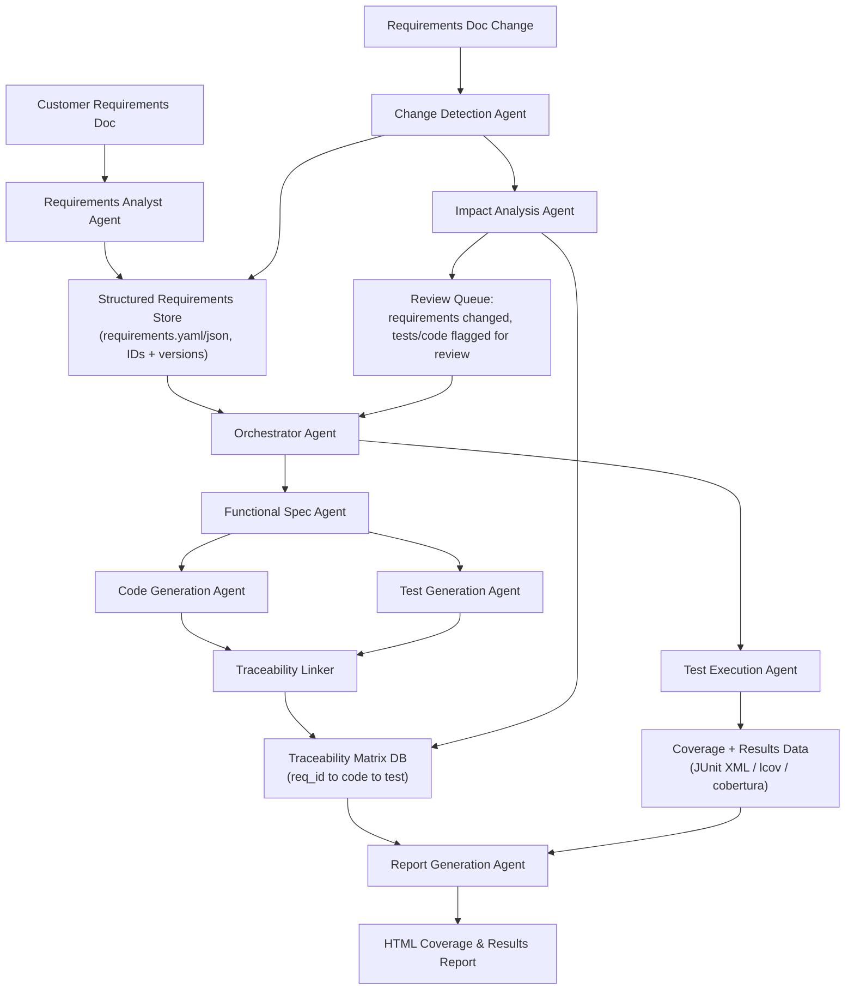

# Agentic Orchestration Plan: Requirements → Code → Tests → Coverage Report

## 1. Goal

Turn a customer requirements document (mixed functional / technical / UX / business requirements) into:
- Implemented functionality (code), traceable to specific requirements.
- Automated tests for each functionality, traceable to the same requirements.
- A mechanism that detects requirement changes and flags/updates only the affected tests (and code).
- A graphical HTML report showing test coverage and test results.

The core idea is a **pipeline of specialized agents coordinated by an orchestrator**, backed by a **traceability matrix** (requirement ↔ code ↔ test) that is the single source of truth linking everything together. Without this matrix, "did the test change because the requirement changed" is unanswerable — so it is the most important artifact in the whole system, more important than any individual agent.

---

## 2. High-Level Architecture



---

## 3. Agent Roles

### 3.1 Requirements Analyst Agent
- **Input:** Raw customer requirement document (Word/PDF/Markdown/email).
- **Output:** Structured, atomic, uniquely-ID'd requirements in a machine-readable store (e.g. `requirements.yaml`), tagged by type: `functional`, `technical`, `ux`, `business`.
- **Responsibilities:**
  - Split the document into atomic, testable requirement statements (one concern per ID).
  - Assign stable IDs (e.g. `REQ-FUNC-012`, `REQ-UX-004`) that never get reused, even if content changes.
  - Flag ambiguous/untestable requirements back to a human (business analyst/customer) for clarification — do not let the pipeline silently guess.
  - Version every requirement (content hash + semantic version) so later changes are detectable.

### 3.2 Functional Spec Agent
- **Input:** One or more related requirement IDs.
- **Output:** A concise technical spec per feature/user story (acceptance criteria, edge cases, data shapes, UX notes) linked to source requirement IDs.
- **Responsibilities:** Bridge the gap between "what the customer said" and "what a coding agent can implement," without inventing new business rules.

### 3.3 Code Generation Agent (per feature/module)
- **Input:** Functional spec + acceptance criteria.
- **Output:** Implementation code, with a header/metadata comment or sidecar file referencing the requirement ID(s) it satisfies.
- **Responsibilities:** Implement only what the spec covers. Should run in parallel per independent feature/module (fan-out), since features are often independent.

### 3.4 Test Generation Agent
- **Input:** Same functional spec + acceptance criteria used by the Code Generation Agent (not the code itself, to avoid "testing the implementation instead of the requirement").
- **Output:** Test cases (unit/integration/UI) tagged with the requirement ID(s) they verify, e.g. via a tag/annotation (`@requirement("REQ-FUNC-012")`, or a naming convention / metadata file).
- **Responsibilities:** One or more tests per acceptance criterion. Include negative/edge cases implied by UX and business requirements, not just happy path.

### 3.5 Traceability Linker (can be a lightweight script/agent, not necessarily LLM-based)
- **Input:** Code artifacts + test artifacts + requirement IDs.
- **Output:** Updates the central **Traceability Matrix** (a simple DB/JSON/CSV: `requirement_id, requirement_hash, code_files[], test_files[], status`).
- **Responsibilities:** The backbone that makes impact analysis possible later.

### 3.6 Test Execution Agent
- **Input:** Test suite.
- **Output:** Test results (pass/fail) + coverage data in standard formats (JUnit XML, lcov/cobertura/opencover depending on stack).
- **Responsibilities:** Run tests in CI or locally, normalize output format regardless of language/framework used.

### 3.7 Change Detection Agent
- **Input:** New version of the customer requirements document.
- **Output:** A diff of requirements: added / removed / modified (with old vs. new content), compared against the stored requirement hashes.
- **Responsibilities:** Never silently overwrite a requirement — always produce an explicit diff for the Impact Analysis Agent and for human review.

### 3.8 Impact Analysis Agent
- **Input:** Requirement diff + Traceability Matrix.
- **Output:** A **review list**: "`REQ-FUNC-012` changed → tests [t1, t2] and code [f1.ts] are potentially stale, please review."
- **Responsibilities:**
  - For modified requirements: flag linked tests/code for human + agent review (do not auto-rewrite tests silently — regenerate a *proposed* updated test and show a diff for approval).
  - For removed requirements: flag linked tests/code for deprecation review.
  - For new requirements: route to Functional Spec Agent to start the normal pipeline.

### 3.9 Report Generation Agent
- **Input:** Test results + coverage data + Traceability Matrix.
- **Output:** A static **HTML report** with:
  - Overall coverage % (lines/branches), per-module breakdown.
  - Pass/fail results per test, grouped by requirement.
  - A traceability view: requirement → tests → pass/fail → coverage, so you can see at a glance which *requirements* (not just which code lines) are actually verified.
  - Highlighting of requirements whose tests are stale/under-review (from the Impact Analysis Agent).

### 3.10 Orchestrator Agent
- Coordinates the sequence/fan-out above, owns the overall workflow state machine, decides when to re-trigger steps (e.g., requirement changed → re-run only affected branch, not the whole pipeline), and surfaces items that need human approval (ambiguous requirements, proposed test changes, deprecated tests).

### 3.11 (Optional) Review/QA Agent
- Performs a final automated sanity pass: do all requirements have at least one linked test? Is coverage below threshold anywhere? Are there tests with no linked requirement ("orphan tests")? Produces a checklist before sign-off.

---

## 4. Orchestration Pattern

Use a **pipeline + fan-out/fan-in pattern with a shared state store**, not a single monolithic agent:

- **Fan-out:** Independent features/requirements are processed in parallel by their own Code Generation / Test Generation agent instances (fast, isolated, safe to parallelize).
- **Fan-in:** Traceability Linker and Report Generation Agent aggregate everything back into one matrix/report.
- **Event-driven re-entry:** The Change Detection → Impact Analysis loop re-enters the pipeline only for the affected requirement IDs, not a full re-run — this is what keeps "requirement changes → review only what's needed" cheap and fast.
- **Human-in-the-loop gates:** Ambiguous requirements, proposed test rewrites, and deprecated-test decisions should always pause for human approval rather than auto-applying — this avoids silently drifting from what the customer actually asked for.

This maps well onto either:
- A custom orchestrator script that calls specialized agent prompts in sequence/parallel (simplest, most controllable).
- A graph-based multi-agent framework (e.g. LangGraph, CrewAI, AutoGen) if you want built-in state/branching management.
- VS Code custom chat modes / agent files, each scoped to one of the roles above (Requirements Analyst, Code Generation, Test Generation, Impact Analysis, Report Generation), invoked in sequence from a top-level orchestrating prompt.

---

## 5. Key Artifacts (the "glue" between agents)

| Artifact | Purpose |
|---|---|
| `requirements.yaml` (or JSON) | Atomic, ID'd, versioned/hashed requirements, typed (functional/technical/ux/business) |
| `traceability-matrix.json` | `requirement_id ↔ code files ↔ test files ↔ status (ok/stale/orphan)` |
| `test-results.xml` (JUnit format) | Normalized test pass/fail output regardless of language |
| `coverage.xml` / `lcov.info` | Normalized coverage data regardless of language |
| `report.html` | Final human-facing dashboard combining the above |
| `review-queue.json` | Pending items needing human sign-off (ambiguous reqs, proposed test diffs, orphan tests) |

Tagging convention example (language-agnostic idea, adapt to your stack):
```text
// Covers: REQ-FUNC-012, REQ-UX-004
```
or a dedicated attribute/decorator per test framework (e.g. `[Trait("Requirement","REQ-FUNC-012")]` in .NET, `pytest.mark.requirement("REQ-FUNC-012")` in Python, a custom Jest `test.each` tag, etc.)

---

## 6. Suggested Toolchain by Layer

- **Coverage/results aggregation → HTML:** ReportGenerator (.NET/any via cobertura), Istanbul/nyc + `nyc report --reporter=html` (JS/TS), coverage.py + `coverage html` (Python), JaCoCo (Java) — all can emit or be post-processed into one combined static HTML site. Allure is a good option if you want a single report that merges results + history + categorization nicely.
- **Traceability matrix:** Start simple — a JSON/YAML file in the repo, versioned in git, so every change is diffable and reviewable like code. Only move to a database if the requirement count gets large (hundreds+).
- **Change detection:** Git diff on `requirements.yaml` plus content-hash comparison per requirement ID is usually sufficient; no special tooling needed.

---

## 7. Suggested Rollout Phases

1. **Phase 1 – Foundation:** Requirements Analyst Agent + `requirements.yaml` schema + manual review gate. Get atomic, ID'd requirements before generating anything else.
2. **Phase 2 – Core pipeline:** Functional Spec → Code Generation + Test Generation (parallel) → Traceability Linker. Validate on 2-3 features end-to-end before scaling.
3. **Phase 3 – Execution & reporting:** Test Execution Agent + Report Generation Agent producing the HTML dashboard.
4. **Phase 4 – Change management:** Change Detection + Impact Analysis Agent + review queue, closing the loop for requirement updates.
5. **Phase 5 – QA hardening:** Review/QA Agent for orphan-test detection, coverage thresholds, and sign-off checklist.

---

## 8. Key Design Principles

- **One source of truth for requirements**, atomic and ID'd — everything else derives from it.
- **Traceability matrix is mandatory**, not optional — it's what makes "did my tests need to change" answerable automatically.
- **Never auto-silently rewrite tests** on requirement change — always propose a diff and require human approval, since tests encode intent that an LLM may not fully infer from a changed requirement line.
- **Fan-out per feature, fan-in for reporting** — keeps re-runs cheap and parallelizable.
- **Separate the Test Generation Agent's input from the Code Generation Agent's output** (both read the spec, neither reads the other's result) to avoid tests that just mirror implementation bugs.
